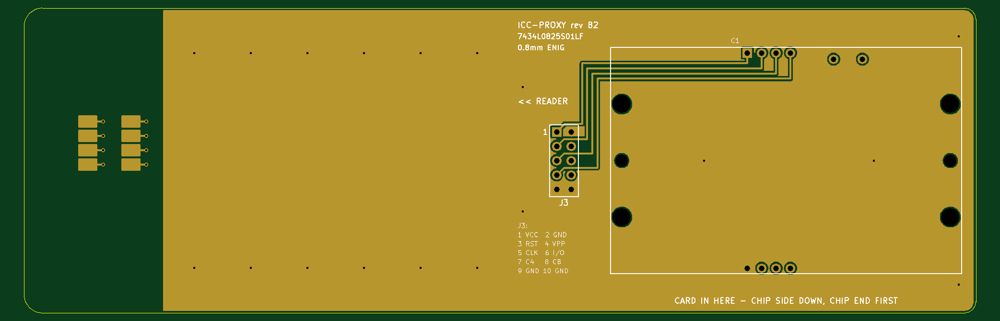
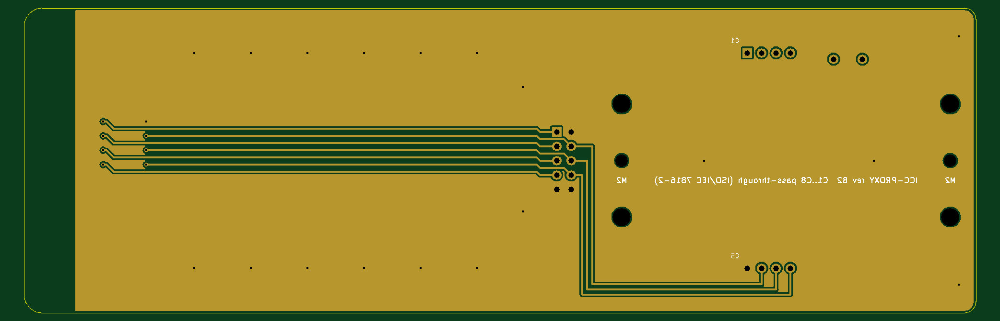

# ICC-Proxy

A pass-through board that sits between an ISO/IEC 7816 contact smart card (ID-1 size) and a card reader, so the signals can be probed with a logic analyzer.
The card connector is an Amphenol FCI **7434L0825S01LF**.

> **Status**: Use at your own risk.

## Overview

| Item | Details |
|---|---|
| Outline | 168.0 × 53.98 mm (card width over the whole length) |
| Layers / thickness | 2 layers, FR-4, **0.8 mm** |
| Surface finish | **ENIG** (gold) |
| Card section | The first 85.6 mm is an ISO/IEC 7810 ID-1 outline with ISO/IEC 7816-2 contacts C1–C8 on the top side |
| Card connector (J2) | Amphenol FCI 7434L0825S01LF (through-hole) |
| Probe header (J3) | 2×5 pins, 2.54 mm pitch (optional) |
| Circuit | C1–C8 wired 1:1. No active parts |

- Nothing protrudes on either side within the first 93 mm, so the card section can be inserted fully into a reader.
- The connector is rotated 90°. Insert the card from the long edge marked `CARD IN HERE`, **chip side down, chip end first**. The card sticks out sideways by about 43 mm.
- Both layers have a GND (C5) copper pour. On the top side the pour starts behind the contact area.

## J3 pinout

| Pin | Signal | Pin | Signal |
|---|---|---|---|
| 1 | C1 VCC | 2 | C5 GND |
| 3 | C2 RST | 4 | C6 VPP |
| 5 | C3 CLK | 6 | C7 I/O |
| 7 | C4 | 8 | C8 |
| 9 | GND | 10 | GND |

S1 and S2 on J2 are the terminals of the connector's built-in card-detect switch. They are not connected to anything (solder them anyway for mechanical strength).

## Files

| Path | Contents |
|---|---|
| `gerber/ICC-Proxy_revB2_gerber_JLCPCB.zip` | Gerber and drill files for ordering (upload as is) |
| `gerber/` | The contents of the ZIP above |
| `kicad/` | Board file created with KiCad 7 (there is no schematic; newer KiCad versions will report that the file was created by an older version) |
| `docs/print_1to1_A4.pdf` | 1:1 check print (A4 landscape, with a 100 mm reference line) |

## Ordering settings (JLCPCB example)

| Option | Setting |
|---|---|
| Layers | 2 |
| PCB thickness | **0.8 mm** |
| Surface finish | **ENIG** |
| Via covering | Tented |
| Board outline tolerance | ±0.1 mm (Precision) recommended |
| Mark on PCB | Remove mark |
| Gold fingers | No |
| PCB assembly | Not used (edge rails would be added and change the board width) |

## Parts

- Amphenol FCI 7434L0825S01LF × 1
- Pin header 2×5, 2.54 mm pitch × 1 (optional)
- M2 self-tapping screws × 2 (optional, to fix the connector)

## References

- [id-1_proxy](https://git.cuvoodoo.info/kingkevin/id-1_proxy) by kingkevin (a board for the same purpose; this board is a new design made to fit a connector that is currently available)
- [ISO 7816 smartcard interface monitor](https://www.cl.cam.ac.uk/~mgk25/cardmonitor) by Markus Kuhn

## License

This project is licensed under the [CERN Open Hardware Licence Version 2 - Permissive](LICENSE) (CERN-OHL-P-2.0).
